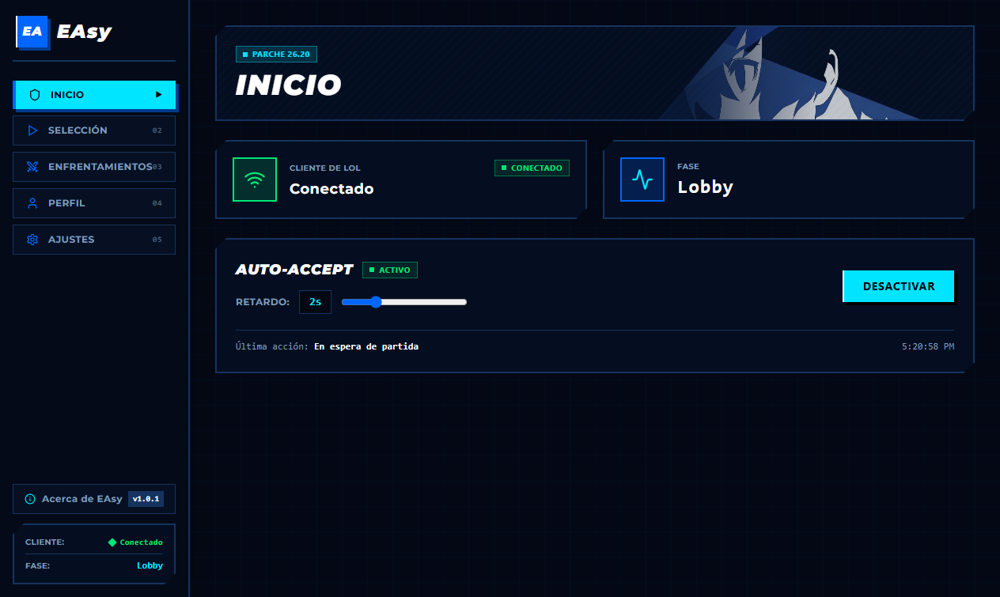
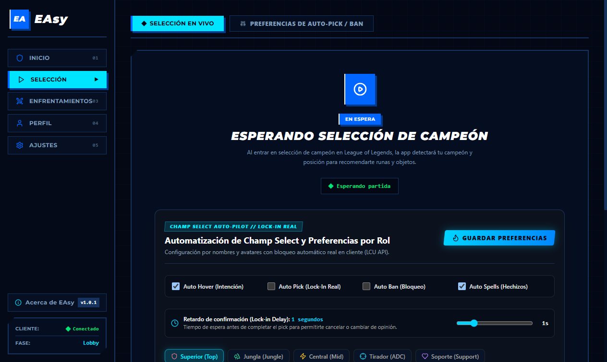
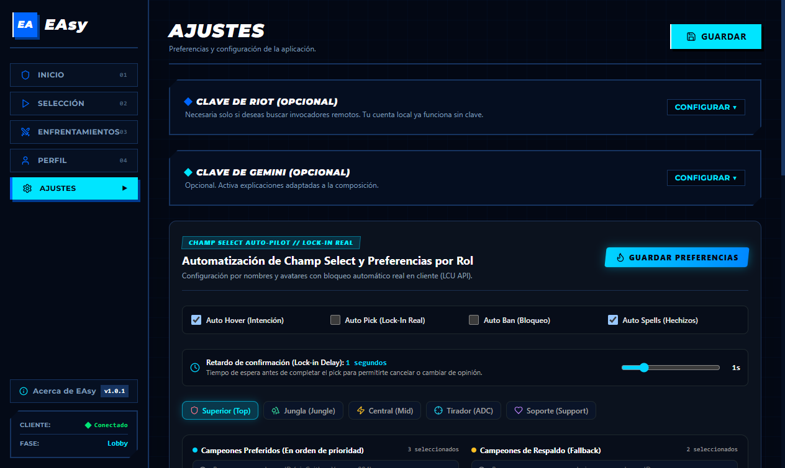

# EAsy (Export Assets)

> **Haciéndole la vida fácil a los loleros.**  
> Un asistente de escritorio local, rápido y sin rodeos para League of Legends en Windows.

---

## ¿De dónde viene el nombre y cuál es la idea?

**EAsy** nace de dos cosas:
1. **Export Assets**: porque exporta e inyecta runas, builds y conjuntos de objetos directamente a tu cliente de League of Legends en un solo clic.
2. **Easy (fácil)**: porque la meta es quitarle la molestia a los que jugamos LoL todos los días.

Se acabó tener 5 pestañas de navegador abiertas que te comen la RAM mientras juegas, buscar guías en páginas lentas a 10 segundos de que empiece la partida, o tener que armar las runas a las carreras con el reloj en contra. **EAsy se encarga de lo tedioso para que tú solo te concentres en ganar tu línea.**

---

## Un vistazo a la app

La interfaz está inspirada en la estética **Dark Hour** de *Persona 3 Reload* (azul marino profundo, cortes diagonales y tipografía inclinada): limpia, legible y optimizada para no consumir recursos mientras juegas.

### Pantalla de Inicio
*Monitoreo en tiempo real del estado de tu cliente de LoL y control rápido de Auto-Accept con retardo configurable.*


### Selección de Campeón
*Detección automática de tu rol, tu campeón y el rival predicho, con estadísticas y recomendaciones de OP.GG.*


### Ajustes y Diagnóstico
*Configuración de tus campeones preferidos, bans automáticos por rol, elo de referencia y panel de soporte.*


---

## Todo lo que EAsy hace por ti

### 1. Auto-Accept con retardo configurable
¿Fuiste a servirte agua o al baño mientras buscabas partida y sonó la cola? EAsy acepta la partida por ti. Puedes configurar un retardo de 1 a 4 segundos para que la aceptación sea natural.

### 2. Cero registros y cero claves obligatorias
No necesitas crearte cuentas en ninguna web, ni pagar nada, ni conseguir claves de desarrollador para jugar. Abres League of Legends, abres EAsy y listo: detecta tu cuenta, nivel, rango de ranked y partidas directamente desde tu propio cliente en tu PC.

### 3. Detección automática en Selección de Campeón
En cuanto entras a la sala de selección, EAsy detecta:
- En qué línea juegas (Superior, Jungla, Medio, Tirador o Soporte).
- El campeón que tienes seleccionado o en hover.
- Quién es tu rival directo en línea.

### 4. Runas óptimas a un solo clic
Con un solo botón, inyecta la página de runas completa y validada directo al cliente oficial. En tu lista de páginas aparecerá como **EAsy**, y cada vez que importes una nueva, limpia automáticamente las anteriores para que no se te acumule basura.

### 5. Conjuntos de objetos (Item Sets) en la tienda in-game
Te arma la build completa directamente en la tienda del juego:
- **Objetos iniciales** (incluyendo soporte como Atlas Mundial si vas de support).
- **Botas recomendadas**.
- **Objetos centrales (Core Build)**.
- **Opciones situacionales** adaptadas al daño del rival.
- **Consumibles y pociones**.

### 6. Metagame y estadísticas reales de OP.GG
Las recomendaciones no son inventadas: vienen de millones de partidas analizadas en el parche actual (**26.20**). Además, puedes elegir con qué nivel de juego quieres comparar tus datos (Esmeralda+, Diamante+, Máster+ o todos los rangos).

### 7. Todos los campeones al día
El catálogo de campeones se sincroniza de forma dinámica con Data Dragon oficial y el cliente de LoL. Resuelve automáticamente campeones nuevos y recién salidos (como Yunara), sin listas fijas en el código.

### 8. Auto-Pick y Auto-Ban de respaldo
Por seguridad, el auto-pick viene apagado por defecto. Pero si tienes que apartarte del teclado durante la fase de selección, puedes armar una lista de prioridades de campeones y de bans para cada posición. EAsy elegirá o bloqueará el primer campeón disponible de tu lista.

### 9. Opciones avanzadas (100% opcionales)
- **Inteligencia Artificial con Google Gemini**: Si quieres explicaciones detalladas y razonamientos de por qué funciona cada objeto contra la composición enemiga, puedes conectar tu clave gratuita de Google AI Studio.
- **Riot Games Developer Key**: Si quieres buscar el historial de invocadores remotos o amigos que no están en tu PC, puedes ingresar una clave de Riot Developer.
- *Si no pones ninguna clave, la app sigue funcionando al 100% con OP.GG y tu cliente local.*

---

## Cómo instalarlo en 1 minuto

1. Entra a la sección de [Releases](https://github.com/infinitummm/itero-local/releases) y descarga el instalador: **`EAsy Setup 1.0.1.exe`**.
2. Haz doble clic para instalar. Se instala en tu carpeta de usuario (`%LOCALAPPDATA%\Programs\EAsy`) sin pedir permisos de Administrador ni tocar archivos protegidos de Windows.
3. **¿Te sale el aviso azul de Windows SmartScreen ("Windows protegió su PC")?**  
   Es totalmente normal: como EAsy es un proyecto independiente nuevo y no paga un certificado comercial de Microsoft de cientos de dólares al año, Windows te avisará la primera vez.  
   - Haz clic en **"Más información"**.  
   - Luego en **"Ejecutar de todas formas"**.  
   - Solo te lo preguntará una vez.
4. Abre League of Legends, abre EAsy ¡y a jugar!

---

## Para desarrolladores (Compilar desde el código)

Si quieres trastear con el código o compilar tu propia versión:

```bash
# 1. Clonar el repositorio
git clone https://github.com/infinitummm/itero-local.git
cd itero-local

# 2. Instalar dependencias
npm install

# 3. Correr en modo desarrollo con recarga rápida (HMR)
npm run dev

# 4. Correr la suite de pruebas unitarias (391 tests)
npm test

# 5. Generar el instalador ejecutable para Windows (.exe)
npx electron-builder --win nsis
```

El instalador quedará en `release/EAsy Setup 1.0.1.exe`.

---

## Privacidad y Seguridad

- **100% en tu ordenador**: EAsy no envía tus datos a servidores externos ni recopila telemetría.
- **Base de datos local**: Tus ajustes, historial y preferencias se guardan en tu equipo en SQLite (`%APPDATA%\proyecto-itero`) cifradas localmente con Windows DPAPI y AES-256-GCM.
- **Limpieza segura**: Puedes borrar en cualquier momento las páginas y conjuntos creados por la app desde la sección *Avanzado / Diagnóstico* en Ajustes.

---

## Descargo legal

Este proyecto es una aplicación creada por fans sin fines de lucro. No está afiliada, respaldada ni asociada con **Riot Games, Inc.**, **Atlus Co., Ltd.** ni **Sega Corporation**.

- *League of Legends* y todos los activos relacionados son marcas comerciales o marcas registradas de Riot Games, Inc.
- Las referencias visuales y tipográficas inspiradas en *Persona 3 Reload* pertenecen a Atlus y Sega.
