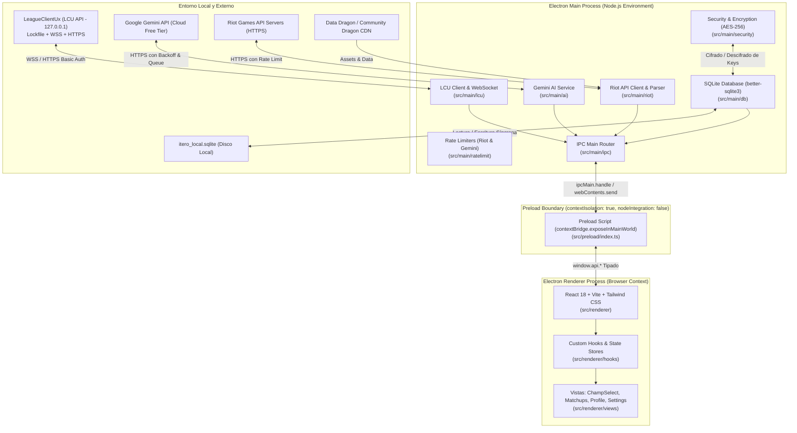

# Arquitectura del Sistema (ARCHITECTURE.md)

## 1. Justificación y Selección del Stack Tecnológico

Para una aplicación de escritorio local para *League of Legends* en Windows, se evaluaron dos arquitecturas principales: **Electron + React + TypeScript + SQLite** frente a **Tauri + React + TypeScript + SQLite (Rust)**.

### 1.1. Análisis Comparativo

| Dimensión | Electron + React + TypeScript + SQLite | Tauri (Rust) + React + TypeScript + SQLite |
| :--- | :--- | :--- |
| **Conexión LCU (HTTPS autofirmado)** | **Excelente:** Node.js permite nativamente configurar `rejectUnauthorized: false` en agentes HTTPS y WebSocket (`ws`) con total control y sin bloqueos de seguridad del WebView. | **Complejo:** El WebView2 de Windows bloquea certificados SSL autofirmados por defecto. Obliga a redirigir todas las peticiones de red y WebSockets a través de comandos IPC en Rust (`reqwest` + `tokio-tungstenite`). |
| **Herramientas y Entorno de Desarrollo** | **Óptimo:** Ecosistema 100% TypeScript/Node.js. No requiere compiladores externos de C++ o Rust en la máquina local para la lógica de negocio. Compatible de inmediato con el agente implementador (OpenCode). | **Exigente:** Requiere la instalación del toolchain completo de Rust (`rustc`, `cargo`) y Microsoft Visual C++ Build Tools (varios GBs), aumentando la fricción y posibles fallos en el worktree del agente. |
| **Rendimiento y Latencia en Champ Select** | **Excelente:** `better-sqlite3` ejecuta consultas síncronas en disco en < 1 ms. La memoria adicional de Chromium (~80-120 MB en una app optimizada) es insignificante en PCs modernos donde corre *League of Legends*. | **Sobresaliente:** Binario ultraligero (~15 MB) y menor consumo de RAM (~30-50 MB), pero con mayor complejidad de serialización IPC entre Rust y JavaScript. |
| **Ecosistema de Herramientas de LoL** | **Estándar de la Industria:** Todas las herramientas reconocidas (Blitz, Porofessor, Mobalytics, Champ-R) utilizan Electron/Node por su madurez comprobada interactuando con `LeagueClientUx` y el `lockfile`. | **Menos común:** Comunidad pequeña y escasa documentación o librerías comunitarias para el ecosistema LCU en Rust. |
| **Velocidad de Pruebas Unitarias** | **Inmediata:** Vitest corre en memoria simulando Node.js con mocks instantáneos de red y archivos en TypeScript. | **Mixta:** Requiere tests separados en `cargo test` para Rust y Vitest para la UI. |

### 1.2. Decisión Arquitectónica
Se selecciona **Electron + React + TypeScript + Vite + SQLite**.
**Motivos determinantes:**
1. Manejo nativo e indiscutible del certificado SSL autofirmado de la LCU API y WebSockets sin bloqueos de WebView.
2. Homogeneidad del lenguaje (TypeScript de extremo a extremo), permitiendo contratos e interfaces compartidas e inviolables entre el backend de Node y el frontend de React.
3. Máxima compatibilidad y velocidad de implementación para OpenCode, permitiendo centrarse en la robustez de los algoritmos de rate-limiting, parsing de partidas y sincronización sin batallar con compilaciones de Rust.

### 1.3. Estrategia de Motor SQLite (Nativo vs Rebuild)
El sistema soporta dos vías para la persistencia síncrona en SQLite:

1. **`node:sqlite` (Recomendado y por Defecto):**
   - Integrado de forma oficial y nativa en Node.js (desde v22.5.0) y en Electron 34+ / 44+.
   - **Ventajas:** Cero dependencias C++, cero necesidad de Visual Studio C++ Build Tools o `node-gyp`. No sufre desajustes de ABI (`NODE_MODULE_VERSION`) entre Node y Electron.
   - **Sintaxis:** Usa la clase `DatabaseSync` (`db.exec()`, `db.prepare().get()`, `db.prepare().run()`), idéntica conceptualmente a `better-sqlite3`.

2. **`better-sqlite3` (Con Rebuild Nativo):**
   - Si se prefiere usar `better-sqlite3`, requiere compilar el addon C++ para la versión de ABI de Electron.
   - **Comando exacto de reconstrucción nativa:**
     ```bash
     npx @electron/rebuild -f -w better-sqlite3
     ```
     *(Requiere tener instalado Visual Studio con el workload "Desktop development with C++").*
   - Si no se cuenta con Visual Studio Build Tools en la máquina de desarrollo, `node:sqlite` es la alternativa nativa equivalente sin fricciones.

---

## 2. Diagrama del Modelo de Procesos y Seguridad

Electron opera con un modelo de procesos separados por seguridad:



### 2.1. Políticas de Seguridad (Electron Sandbox)
- `nodeIntegration: false` en todas las ventanas.
- `contextIsolation: true` mandatorio.
- Acceso restringido del Renderer al Main exclusivamente a través de las funciones expuestas en `window.api` dentro de `src/preload/index.ts`.
- Validación estricta de parámetros en cada manejador `ipcMain.handle`.

---

## 3. Estructura de Carpetas del Proyecto

```text
ProyectoItero/
├── docs/                               # Documentación y contratos del proyecto
│   ├── SPEC.md                         # Especificación funcional
│   ├── ARCHITECTURE.md                 # Arquitectura y propiedad de carpetas
│   ├── CONTRACTS.md                    # Contratos de interfaces, eventos y BD
│   ├── TASKS.md                        # Desglose de tareas por agente
│   ├── PROMPT_OPENCODE.md              # Instrucciones maestras para OpenCode
│   ├── REQUESTS.md                     # Canal de dudas y solicitudes de OpenCode
│   └── PROGRESS.md                     # Registro de avance de tareas
├── src/
│   ├── main/                           # Backend de Electron (Node.js)
│   │   ├── index.ts                    # Punto de entrada de Electron Main
│   │   ├── lcu/                        # Conexión LCU, lockfile, WS y Auto-Accept
│   │   ├── ratelimit/                  # Rate limiters token bucket (Riot y Gemini)
│   │   ├── riot/                       # Cliente Riot API (Account, Match-V5, DDragon)
│   │   ├── db/                         # Capa SQLite (better-sqlite3, esquemas, repos)
│   │   ├── security/                   # Cifrado local de API Keys (AES-256-GCM)
│   │   ├── ai/                         # Servicio de Gemini, prompts y cola
│   │   └── ipc/                        # Registro de canales y routers IPC
│   ├── preload/                        # Puente seguro contextBridge
│   │   └── index.ts                    # Exposición tipada de window.api
│   ├── renderer/                       # Frontend (React 18 + TypeScript + Vite)
│   │   ├── index.html                  # Plantilla HTML
│   │   ├── main.tsx                    # Entrada de React
│   │   ├── App.tsx                     # Componente raíz con layout y navegación
│   │   ├── views/                      # Pantallas principales
│   │   │   ├── DashboardView.tsx       # Estado general, conexión y resumen
│   │   │   ├── ChampSelectView.tsx     # Vista en vivo de selección de campeón
│   │   │   ├── MatchupView.tsx         # Análisis táctico con Gemini
│   │   │   ├── ProfileView.tsx         # Historial, winrates y maestrías
│   │   │   └── SettingsView.tsx        # Configuración de keys, delays y toggles
│   │   ├── components/                 # Componentes UI reutilizables
│   │   ├── hooks/                      # Custom hooks para eventos LCU e IPC
│   │   └── styles/                     # Estilos globales y Tailwind CSS
│   └── shared/                         # Contratos y tipos compartidos
│       ├── types.ts                    # Tipos de dominio (Campeón, Runa, Match, etc.)
│       ├── contracts.ts                # Interfaces públicas de servicios
│       ├── events.ts                   # Eventos LCU y canales IPC
│       └── constants.ts                # Constantes del juego y límites
├── tests/                              # Suite de pruebas automatizadas (Vitest)
│   ├── mocks/                          # Mocks de LCU lockfile, Riot API y WebSocket
│   ├── lcu/                            # Tests del cliente LCU y auto-accept
│   ├── ratelimit/                      # Tests de limitadores de tasa
│   ├── riot/                           # Tests de Riot API y Match-V5 parser
│   └── db/                             # Tests de SQLite y repositorios
├── package.json                        # Dependencias y scripts de ejecución
├── tsconfig.json                       # Configuración base de TypeScript
├── tsconfig.node.json                  # TSConfig para Main y Preload
├── vite.config.ts                      # Configuración de Vite para Electron
└── vitest.config.ts                    # Configuración de pruebas Vitest
```

---

## 4. Matriz de Propiedad de Carpetas y Responsabilidades

Para evitar colisiones entre los agentes que trabajan en paralelo en diferentes worktrees de Git, se define una **propiedad estricta y excluyente de carpetas**:

| Carpeta / Archivo | Propietario Exclusivo | Permisos de OpenCode | Descripción |
| :--- | :--- | :--- | :--- |
| `docs/CONTRACTS.md` | **ANTIGRAVITY** | Solo Lectura | Contratos inmutables. Si requiere cambios, usa `docs/REQUESTS.md`. |
| `docs/SPEC.md` | **ANTIGRAVITY** | Solo Lectura | Especificación funcional del sistema. |
| `docs/ARCHITECTURE.md` | **ANTIGRAVITY** | Solo Lectura | Diseño del sistema y mapa de carpetas. |
| `docs/TASKS.md` | **ANTIGRAVITY** | Solo Lectura | Listado maestro de tareas. |
| `docs/PROMPT_OPENCODE.md` | **ANTIGRAVITY** | Solo Lectura | Prompt maestro para la sesión de OpenCode. |
| `docs/REQUESTS.md` | **OPENCODE** | Lectura y Escritura | Canal formal de dudas y solicitudes de cambio de contrato. |
| `docs/PROGRESS.md` | **OPENCODE** | Lectura y Escritura | Registro de tareas completadas por OpenCode. |
| `src/shared/` | **ANTIGRAVITY** | Solo Lectura | Tipos, contratos, constantes y eventos compartidos. |
| `src/main/lcu/` | **OPENCODE** | Lectura y Escritura | Conector LCU, WebSocket, lockfile y Auto-Accept. |
| `src/main/ratelimit/` | **OPENCODE** | Lectura y Escritura | Token bucket para Riot API y Gemini. |
| `src/main/riot/` | **OPENCODE** | Lectura y Escritura | Cliente Riot API, Data Dragon y parser de Match-V5. |
| `src/main/db/` | **OPENCODE** | Lectura y Escritura | Capa SQLite, esquemas, migraciones y repositorios. |
| `src/main/security/` | **OPENCODE** | Lectura y Escritura | Módulo de cifrado y descifrado de credenciales. |
| `tests/lcu/`, `tests/ratelimit/`, `tests/riot/`, `tests/db/`, `tests/mocks/` | **OPENCODE** | Lectura y Escritura | Pruebas unitarias de los módulos del backend. |
| `src/main/ai/` | **ANTIGRAVITY** | Solo Lectura para OpenCode | Servicio de Gemini, prompts de IA y lógica de inferencia. |
| `src/main/ipc/` | **ANTIGRAVITY** | Solo Lectura para OpenCode | Enrutador IPC de Electron y puente con servicios. |
| `src/main/index.ts` | **ANTIGRAVITY** | Solo Lectura para OpenCode | Inicialización de ventana Electron y ciclo de vida. |
| `src/preload/` | **ANTIGRAVITY** | Solo Lectura para OpenCode | Exposición de `window.api` mediante contextBridge. |
| `src/renderer/` | **ANTIGRAVITY** | Solo Lectura para OpenCode | Todo el frontend React, componentes, vistas y estilos. |

### Reglas de Convivencia entre Agentes:
1. **Inviolabilidad de `src/shared/`:** OpenCode **NO TIENE PERMITIDO** modificar ningún archivo dentro de `src/shared/`. Si necesita un nuevo método, campo o tipo, debe registrar la solicitud detallada en `docs/REQUESTS.md`. Antigravity evaluará, actualizará `src/shared/` y `docs/CONTRACTS.md`, y le notificará por el terminal de Orca para que haga merge.
2. **Sin código cruzado en carpetas:** OpenCode trabaja estrictamente en sus carpetas asignadas. Antigravity no tocará las carpetas de backend de OpenCode durante las fases activas del implementador.
3. **Commits atómicos por tarea:** Cada tarea finalizada por OpenCode debe acompañarse de sus tests unitarios correspondientes pasando al 100% y un commit con mensaje claro.

---

## 7. Capa de Proveedores de IA Intercambiable (Frente 2, REQ-019)

Para garantizar independencia de un único proveedor y permitir la integración futura de modelos locales o proveedores ultrarrápidos (Groq, Mistral, Ollama) sin modificar la lógica de negocio ni romper contratos, Itero Local implementa una arquitectura desacoplada basada en la interfaz canónica `AiProvider`.

### 7.1 Interfaces Canónicas (`src/main/ai/providers/AiProvider.ts`)
```typescript
export interface AiProvider {
  readonly id: string;
  readonly name: string;
  generateText(prompt: string, options?: AiGenerateOptions): Promise<string>;
  generateStructured<T>(prompt: string, schema?: unknown, options?: AiGenerateOptions): Promise<T>;
  generateWithSearch?(prompt: string, options?: AiGenerateOptions): Promise<GroundingResult>;
  getQuotaInfo?(): ProviderQuotaInfo;
}
```

### 7.2 Orquestador y Conmutación Automática ante 429 (`AiProviderManager.ts`)
El orquestador `AiProviderManager` mantiene una lista priorizada de proveedores. Al recibir un error `HTTP 429` (`RESOURCE_EXHAUSTED` / Rate Limit Exceeded) de un proveedor primario, conmuta automáticamente de forma transparente al siguiente proveedor registrado y emite eventos `fallo-cuota-429` y `cambio-proveedor`.

### 7.3 Guía de Extensión para Proveedores Compatibles con OpenAI (Groq / Mistral / Ollama)
Para añadir un nuevo proveedor compatible con OpenAI:
1. Crear `src/main/ai/providers/OpenAiCompatibleProvider.ts` implementando `AiProvider`.
2. Usar el endpoint estándar `POST /chat/completions` con `Authorization: Bearer <API_KEY>` y `response_format: { type: "json_object" }` para `generateStructured`.
3. Registrar la instancia en `AiProviderManager.registerProvider(new OpenAiCompatibleProvider({ id: 'groq', baseUrl: 'https://api.groq.com/openai/v1', model: 'llama-3.3-70b-versatile' }))`.
4. El resto de la aplicación continuará funcionando idénticamente.

